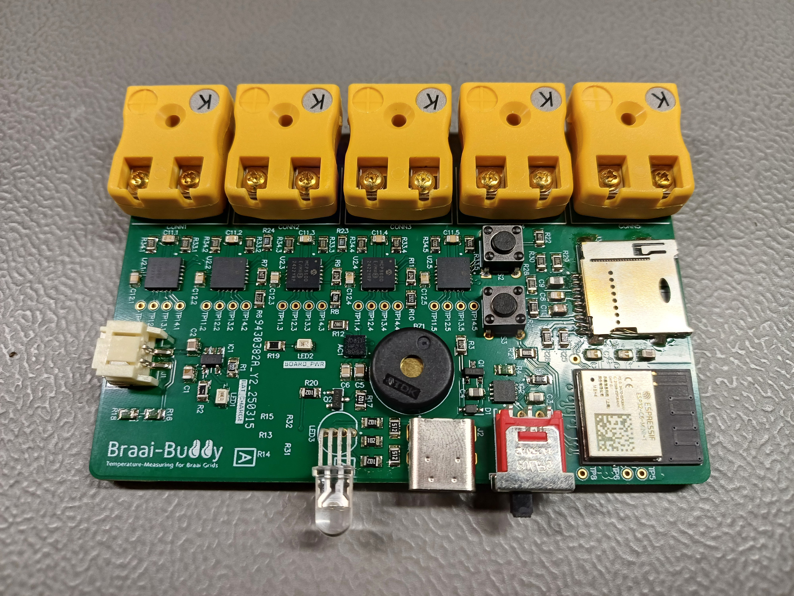
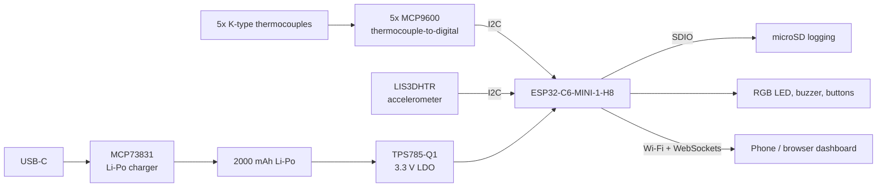

# BraaiBuddy

**A battery-powered, five-channel wireless thermocouple monitor for the braai.** BraaiBuddy tracks meat core temperatures and coal temperatures, logs everything to a microSD card, and serves a live dashboard to your phone over Wi-Fi.

It started as my BEng (Electrical and Electronic) final year project at Stellenbosch University in 2025. I am now continuing it as a personal project, taking it from a working lab prototype to a product-grade prototype.



## Status

| Area | Status |
|---|---|
| PCB design, fabrication and assembly | Done (rev A) |
| Hardware verification | Done |
| Core firmware (sensing, logging, Wi-Fi dashboard) | Done |
| 3D-printed enclosure | In progress |
| Web UI refresh | In progress |
| Meat profiles, doneness presets and alerts | In progress |

## Key specifications

- **Channels:** 5 K-type thermocouple inputs (meat probes and coal probes)
- **Sensing range:** up to about 350 to 400 °C, ±1 °C design target (doneness levels are only about 5 °C apart)
- **Connectivity:** Wi-Fi soft-AP and station mode, live data over WebSockets
- **Logging:** microSD at 1 Hz
- **Power:** 2000 mAh Li-Po, USB-C charging, 2+ hours runtime target (500 mA system budget)
- **Feedback:** RGB status LED, buzzer, two buttons
- **Grid-flip detection:** accelerometer detects when the grid has been turned

## System overview



## Hardware

Designed in Altium Designer. 6-layer board fabricated by JLCPCB and hand-assembled with components from DigiKey.

- **MCU:** ESP32-C6-MINI-1-H8 (Wi-Fi 6, RISC-V, 8 MB flash)
- **Temperature sensing:** 5x MCP9600 on a shared I2C bus, each addressed via a resistor divider on its ADDR pin
- **Motion:** LIS3DHTR 3-axis accelerometer
- **Power:** USB-C (USB 2.0, 5.1 kΩ CC pull-downs), MCP73831 Li-Po charger, TPS785-Q1 3.3 V LDO
- **Storage:** microSD over SDIO with card-detect
- **Layout:** 6 layers with a dedicated ground plane, length-matched USB D+/D- pair and SD data lines

### Design decisions

**Why the MCP9600?** I compared three approaches. The MAX31856 is accurate but uses SPI, and needing five of them made it the most expensive option. An analog thermocouple amplifier with a separate ADC (the ESP32's built-in ADC is not accurate enough) cost more in total than an amplifier with a built-in ADC. The MCP9600 gives cold-junction compensation, an integrated ADC and I2C in one part (±0.5 °C typical, ±1.5 °C max). The MCP9601 adds open and short-circuit probe detection and is a candidate for a later revision.

**Why the ESP32-C6-MINI-1-H8?** The board sits right next to a heat source, so I chose the H8 variant for its higher ambient operating temperature rating. The extra flash also allows logging without an SD card in a simpler future version. The price difference between variants was negligible, and stock availability was good.

**Why 6 layers?** The university's in-house fab only does 2-layer boards, which was not enough for this density and board size. Going to 6 layers also gave a solid ground reference for signal integrity and helped with heat spreading.

**Why not have JLCPCB assemble it?** The ESP32-C6-MINI-1-H8 was not available through their assembly service, minimum order and attrition quantities made it impractical, and the board could not go through a second reflow pass after hand-placing the missing parts. So the PCB was fabricated at JLCPCB and all components were ordered from DigiKey and assembled by hand.

**Thermal design for the enclosure.** I measured about 55 °C at the grid handle, so the 3D-printed housing needs a filament with a heat deflection temperature comfortably above that. The MCP9600's offset and gain errors are lowest around 30 °C, so the enclosure is also designed to keep the internal ambient as close to that as possible.

## Firmware

C++ on the Arduino framework, built with PlatformIO (`Firmware/`).

- 1 ms hardware-timer tick that sets 50, 100, 1000 and 2000 ms task flags (cooperative scheduler)
- Wi-Fi soft-AP plus station mode, with a network configuration page
- Web dashboard served from flash, with live probe data pushed over WebSockets
- 1 Hz temperature logging to microSD
- Task watchdog and a local OTA firmware update page
- Accelerometer-driven grid-flip detection used to trigger and clear LED and buzzer alerts

Hardware bring-up sketches for each subsystem (temperature, accelerometer, buzzer, full system) are in `Firmware/bring-up-tests/`.

## Verification

- **Temperature accuracy:** all five probes tested in boiling water (about 100 °C) and ice water (about 0 °C)
- **Grid-flip detection:** accelerometer Z-axis inversion test, used to step through an alert sequence
- **Power:** 3.3 V rail verification and current-draw measurements against the 2-hour battery budget
- **Logging and web interface:** SD logging at 1 Hz and live dashboard updates confirmed end to end

The full design and test write-up is in [`Report/Final_submitted_report.pdf`](Report/Final_submitted_report.pdf).

## Roadmap

- [ ] Heat-rated 3D-printed enclosure
- [ ] Refreshed web UI
- [ ] Cooking profiles per meat type with doneness presets
- [ ] Alerts when target temperatures are reached
- [ ] Rev B board: MCP9601 probe-fault detection, replaceable battery slot

## Repository layout

```
Altium/BraaiBuddyPCB/   Altium project: schematics, PCB, BOM, Gerbers, STEP model
Altium/All SCH Documents (with info).PDF   Schematics with my design notes
Firmware/               PlatformIO firmware and web UI (data/)
Firmware/bring-up-tests/  Arduino sketches used for hardware bring-up
Report/                 Final year project report
docs/images/            Photos and renders
```

## Author

Estiaan Botha, BEng Electrical and Electronic Engineering (Stellenbosch University, 2025)
